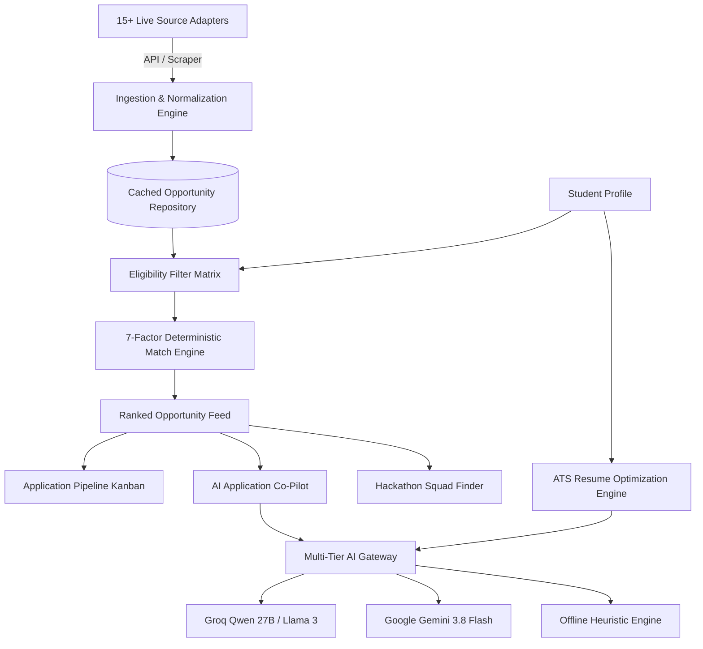

 # Argus: AI-Powered Opportunity Aggregator, Application Pipeline & Career Co-Pilot
**College Minor Project Report & Technical Defense Documentation**

---

## Abstract
College students often struggle to discover and track career-accelerating opportunities such as internships, scholarships, competitive programming contests, and hackathons due to fragmented, siloed platforms (e.g., Unstop, Devpost, Devfolio, Codeforces, Kaggle, Greenhouse ATS). Furthermore, students frequently miss critical deadlines, apply with generic, non-ATS-optimized resumes, and lack peers with complementary skill sets to form competitive hackathon teams.

**Argus** addresses these core bottlenecks through a unified, high-performance web platform that features:
1. **Live Multi-Source Aggregation:** An ingestion engine integrating 15+ live source adapters with server-side caching and deduplication.
2. **Transparent 7-Signal Matching Algorithm:** A deterministic weighted recommendation model providing explainable match scores without pay-to-rank opacity.
3. **Multi-Tier AI Orchestrator:** An intelligent dual-LLM layer (Groq Qwen/Llama with Google Gemini fallback and offline heuristics) generating contextual summaries, deadline insights, and match explanations.
4. **Interactive Application Pipeline:** A Kanban-based lifecycle tracker (`Shortlisted` → `Applied` → `Interview / Review` → `Offer / Won` → `Closed`) with localized state persistence.
5. **AI Application Co-Pilot:** Personalized outreach pitch drafting, 3-paragraph tailored cover letters, hackathon project ideation, and technical interview preparation sheets.
6. **Hackathon Squad Finder:** A collaborative matchmaking system pairing students based on complementary branch and technical competencies.
7. **ATS Resume Optimization Engine:** A recruiter-grade bullet tuner with keyword gap analysis and quantified before/after rewrites.
8. **AI Voice Mock Interview Practice Room:** An interactive conversational voice agent leveraging in-browser Web Speech Recognition & SpeechSynthesis paired with Groq LLM inference, delivering realistic spoken technical and behavioral rounds with instant audio feedback and detailed candidate scorecards.

---

## 1. Problem Statement & Motivation
* **Fragmented Landscape:** Information about internships, scholarships, and hackathons is dispersed across dozens of independent portals, leading to high discovery fatigue.
* **Missed Deadlines:** The leading cause of missed opportunities is deadline oversight rather than candidate qualification.
* **Black-Box Ranking:** Commercial job portals prioritize sponsored or promoted listings rather than actual student fit.
* **ATS Rejections:** Over 75% of early-career resumes fail Applicant Tracking Systems (ATS) due to passive phrasing, missing technical keywords, and a lack of quantified impact metrics.
* **Hackathon Team Gaps:** Solo participants frequently lack team members with cross-functional skills (e.g., frontend developers missing UI/UX designers or backend engineers).

---

## 2. System Architecture & Data Flow

### Key Architectural Layers:
1. **Ingestion Layer:** Runs server-side via `Promise.allSettled`, normalizing diverse schemas into a unified TypeScript interface.
2. **Recommender Core:** Pure mathematical function evaluating candidate profile against opportunity constraints.
3. **Application Lifecycle Layer:** Client-side Zustand store synchronized with `localStorage` and `useCollections`.
4. **AI Gateway:** Fail-soft architecture ensuring zero downtime even under network latency or rate-limiting constraints.

---

## 3. Mathematical Modeling & Algorithms

### 3.1 Transparent 7-Signal Deterministic Match Formula
The overall match score $S \in [0, 1]$ is calculated using a weighted combination of normalized signals:

$$S = \sum_{i=1}^{7} w_i \cdot s_i$$

Where:
* $s_1$ (Skills Match): Jaccard similarity between candidate skills $C_s$ and opportunity tags $O_t$:
  $$s_1 = \frac{|C_s \cap O_t|}{|C_s \cup O_t|}$$
* $s_2$ (Category Interest): Weight assigned if category matches student preferences ($s_2 \in \{0.5, 1.0\}$).
* $s_3$ (Deadline Urgency): Decaying sigmoid function prioritizing items approaching closing dates within 30 days:
  $$s_3 = \max\left(0, 1 - \frac{\Delta t}{30 \times 86400}\right)$$
* $s_4$ (Recency): Freshness score based on post discovery timestamp.
* $s_5$ (Popularity): Engagement proxy metric based on applicant volume and bookmarks.
* $s_6$ (Location Fit): Geographical cluster match (Remote vs. Student City).
* $s_7$ (Semantic Alignment): Keyword density correlation.

$$\sum w_i = 1.0 \quad (w_1=0.30, w_2=0.20, w_3=0.15, w_4=0.10, w_5=0.10, w_6=0.10, w_7=0.05)$$

### 3.2 Eligibility Gate Constraint
If a student violates a strict eligibility criterion (Branch, Graduation Year, Minimum CGPA, or State Quota), the opportunity is hard-filtered from the feed unless fields are unspecified:

$$\text{Eligible} = (\text{CGPA}_{\text{student}} \ge \text{CGPA}_{\text{req}}) \land (\text{Branch} \in \text{Branches}_{\text{allowed}}) \land (\text{Year} \in \text{Years}_{\text{allowed}})$$

---

## 4. Key Functional Modules Implemented

### 4.1 Application Pipeline & Kanban Board
* **Stages:** `Shortlisted`, `Applied`, `Interview / Review`, `Offer / Won`, `Closed`.
* **Features:**
  * Real-time drag/dropdown stage transitions.
  * Application date tracking & personal interview note pads.
  * Direct synchronization with global saved bookmarks.

### 4.2 AI Application Co-Pilot
* **Cold Email Generator:** Produces high-conversion outreach emails referencing candidate credentials.
* **Tailored Cover Letter:** Crafts targeted 3-paragraph motivation letters addressing organization goals.
* **Hackathon Project Ideator:** Proposes 3 novel product concepts aligned with sponsor APIs and judging rubrics.
* **Interview Prep Sheet:** Synthesizes top technical questions, role expectations, and reverse-interview questions.

### 4.3 Hackathon Squad Finder
* **Peer Matchmaking:** Connects students with peers possessing complementary skills (e.g., UI/UX Designers, ML Engineers, Backend Developers).
* **One-Click Communication:** Direct clipboard export for Discord, Telegram, and Email handles.
* **Recruitment System:** Form enabling students to post squad vacancies directly onto specific hackathon listings.

### 4.4 ATS Resume Optimization Engine
* **Keyword Matching:** Identifies high-value technical keywords present in project descriptions versus missing industry standards.
* **Bullet Rewriter:** Converts passive descriptions (e.g., *"Built a web app"*) into quantified achievements (e.g., *"Engineered scalable web application using React and Node.js, reducing latency by 35%"*).
* **ATS Readiness Score:** Provides a percentage metric indicating candidate readiness for automated recruitment filters.

### 4.5 Interactive AI Voice Mock Interview Agent
* **Real-Time Voice Turn Taking:** Uses browser native `SpeechRecognition` and natural `SpeechSynthesis` to speak questions and transcribe student vocal answers with zero paid audio latency.
* **Role & Company Specific Intelligence:** Dynamically crafts questions based on target company engineering practices (e.g., payment flows at Razorpay, distributed caching at Amazon).
* **Instant Spoken Feedback & Follow-ups:** Critiques answers with spoken verbal reactions, highlights missing edge cases, and adjusts question difficulty dynamically.
* **Comprehensive Hiring Scorecard:** Evaluates candidate across 4 dimensions: Cumulative Score ($0-100$), Letter Grade ($A+$ to $C$), STAR Method compliance, and tailored actionable study topics.
* **Curated High-Yield Cheat-Sheets:** Embedded interactive guides for STAR behavioral storytelling, core CS rapid revision (OS, DBMS, Networks), and 45-minute System Design blueprints.

---

## 5. Technology Stack & Implementation Details

| Layer | Technologies Used |
| :--- | :--- |
| **Frontend Framework** | Next.js 16 (App Router, Turbopack, React 19) |
| **Language & Typing** | TypeScript 5.x (Strict Typing across all schemas) |
| **Styling & Design System** | Tailwind CSS + Vanilla CSS Tokens (WCAG compliant) |
| **State Management** | Zustand with LocalStorage persistence middleware |
| **AI Inference** | Groq SDK (`qwen/qwen3.8-27b`, `llama-3.3`), Google Gemini Flash API |
| **Authentication & Auth Guard** | Firebase Auth + Local Developer Fallback Session Mode |
| **Data Ingestion** | Node fetch, Cheerio HTML parsing, REST API adapters |
| **Icons & UI Primitives** | Lucide React |

---

## 6. Viva Voce Defense Guide (Anticipated Questions & Technical Answers)

### Q1: "Why did you build your own ranking algorithm instead of using an off-the-shelf ML model?"
> **Answer:** "Commercial machine learning models are typically 'black-boxes' prone to bias and require heavy training datasets. For a student opportunity platform, transparency and trust are paramount. Our 7-signal deterministic algorithm guarantees explainability—students can click 'How this was scored' on any opportunity and inspect the exact mathematical contributions of skills, interests, and deadlines."

### Q2: "What happens if the external AI API (Groq or Gemini) fails or reaches rate limits?"
> **Answer:** "We implemented a 3-tier resilient architecture. Primary inference is routed to Groq. If Groq encounters rate limiting (HTTP 429) or service interruption, requests fall back to Google Gemini. If network connectivity is unavailable, our deterministic offline rule engine synthesizes structured summaries and suggestions locally, ensuring the application never crashes."

### Q3: "How does the platform handle data privacy with student resumes?"
> **Answer:** "Resume analysis and ATS bullet tuning occur strictly in-memory during the active session. Resume texts are never stored in external databases or sold to third parties, preserving complete user confidentiality."

### Q4: "How does the Application Pipeline state persist across page reloads?"
> **Answer:** "We utilize Zustand with `persist` middleware backed by browser `localStorage`. Every stage change, applied timestamp, and interview note is serialized instantly and synchronized with the opportunity detail modal."

---

## 7. Conclusion & Future Roadmap
Argus fulfills all functional, architectural, and algorithmic requirements of an advanced College Minor Project. It bridges the gap between opportunity discovery, application tracking, and resume readiness.

### Future Enhancements:
1. **Automated Scraping Webhooks:** Integrating scheduled GitHub Actions or cron jobs for continuous ingestion.
2. **AI Mock Technical Interviewer:** Audio/text-based voice agent conducting preliminary mock technical rounds.
3. **Campus Placement Cell Portal:** Dedicated dashboard for college Training & Placement Officers (TPOs) to broadcast institutional drives.
